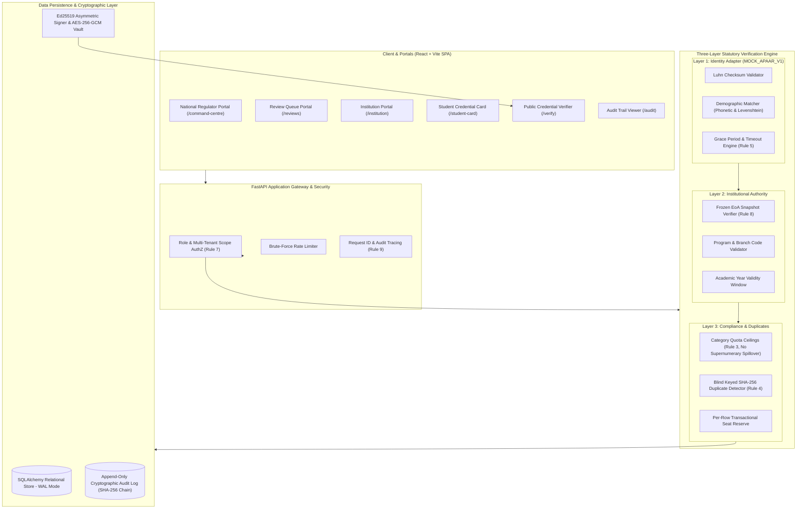

# APAAR Connect (AICTE India)
### Unified Student Admission Record Verification & Seat Compliance Platform
**AICTE Regulatory Sandbox Prototype • Modular Monolith Architecture**

> [!IMPORTANT]
> **Regulatory Disclaimer (Rule 2)**: All data is synthetic. Simulated APAAR service. Identity adapter is explicitly labeled **`MOCK_APAAR_V1`** everywhere. All performance benchmarks represent **demo-scale** measurements and must never be represented as national-scale.

---

## 🏛️ System Overview

Approved higher education institutions submit student-level admission records against AICTE-approved statutory seat matrices. Every record passes **THREE independent verification layers**:
1. **L1 Identity Verification (`MOCK_APAAR_V1`)**: Demographic match against simulated national identity adapter (handles `PASS`, `FAIL`, and `UNAVAILABLE`).
2. **L2 Institutional Authority**: Frozen statutory approval snapshot integrity (valid dates, approved program, approved category quota).
3. **L3 Admission & Seat Compliance**: Per-category intake capacity (Rule 3) and keyed-hash duplicate detection (Rule 4).

A record is **VERIFIED** only if all three layers pass. Exceptions open a human review case with explainable priority scores (Rule 6). Verified students receive a signed, revocable, **privacy-minimal QR credential** (Rule 10).

---

## 🏗️ Architecture Diagram



---

## 📋 Non-Negotiable Rules Compliance Matrix

| Rule # | Requirement | Implementation & Proof Location |
| :--- | :--- | :--- |
| **Rule 1** | APAAR is SIMULATED. Labeled `MOCK_APAAR_V1` everywhere. | [`backend/services/identity_adapter.py`](file:///c:/Users/swarup/OneDrive/Documents/SIH2.0/apaar-connect/backend/services/identity_adapter.py) |
| **Rule 2** | Synthetic data. Show footer banner: `"Synthetic data. Simulated APAAR service."` | [`frontend/src/components/design-system/FooterBanner.tsx`](file:///c:/Users/swarup/OneDrive/Documents/SIH2.0/frontend/src/components/design-system/FooterBanner.tsx) |
| **Rule 3** | Seat checks are PER CATEGORY. Regular students never consume supernumerary seats. Rule versioning. | [`backend/services/seat_compliance.py`](file:///c:/Users/swarup/OneDrive/Documents/SIH2.0/apaar-connect/backend/services/seat_compliance.py) |
| **Rule 4** | APAAR duplicate match opens a review case. NEVER auto-merges, auto-rejects, or auto-accuses. | [`backend/services/submission_service.py`](file:///c:/Users/swarup/OneDrive/Documents/SIH2.0/apaar-connect/backend/services/submission_service.py) |
| **Rule 5** | `UNAVAILABLE` identity service is not PASS and not FAIL. Record stays `PROVISIONAL`. | [`backend/tests/test_must_pass_contract.py:test_contract_6`](file:///c:/Users/swarup/OneDrive/Documents/SIH2.0/apaar-connect/backend/tests/test_must_pass_contract.py) |
| **Rule 6** | No ML/score may reject a student. Scores only PRIORITISE human review; show components & reason codes. | [`backend/services/anomaly_detection.py`](file:///c:/Users/swarup/OneDrive/Documents/SIH2.0/apaar-connect/backend/services/anomaly_detection.py) |
| **Rule 7** | Server-side authorization on every endpoint (role + institution scope). URL tampering blocked. | [`backend/security/authz.py`](file:///c:/Users/swarup/OneDrive/Documents/SIH2.0/apaar-connect/backend/security/authz.py) |
| **Rule 8** | Records are versioned. Approval snapshots are immutable (SHA-256 integrity hash). | [`backend/models/approval.py`](file:///c:/Users/swarup/OneDrive/Documents/SIH2.0/apaar-connect/backend/models/approval.py) |
| **Rule 9** | Every state change writes an audit event (`actor`, `action`, `entity`, `reason`, `timestamp`, `request_id`). | [`backend/services/audit.py`](file:///c:/Users/swarup/OneDrive/Documents/SIH2.0/apaar-connect/backend/services/audit.py) |
| **Rule 10** | APAAR stored encrypted via AES-256-GCM + keyed HMAC-SHA256 hash. Shown masked `XXXX-XXXX-1234`. Never in URLs/logs/QR. | [`backend/security/crypto.py`](file:///c:/Users/swarup/OneDrive/Documents/SIH2.0/apaar-connect/backend/security/crypto.py) |
| **Rule 11** | Every dashboard number is computed dynamically from database. No hard-coded numbers. | [`backend/services/analytics_service.py`](file:///c:/Users/swarup/OneDrive/Documents/SIH2.0/apaar-connect/backend/services/analytics_service.py) |
| **Rule 12** | Typed errors `{"code","message","field?","details?"}`. Invalid state transitions return HTTP 409. | [`backend/schemas/errors.py`](file:///c:/Users/swarup/OneDrive/Documents/SIH2.0/apaar-connect/backend/schemas/errors.py) |

---

## 🔄 Admission Lifecycle State Machine

```
              ┌─────────────────────────────────────────────────────────────┐
              │                                                             │
              ▼                                                             │
        [PROVISIONAL] ──(L1/L2/L3 Pass)──► [CONFIRMED] ────► [ACTIVE]       │
              │                                  │             │            │
         (Exception)                        (Cancelled)        ├─► [COMPLETED]
              ▼                                  │             ├─► [WITHDRAWN]
        [UNDER_REVIEW]                           ▼             ├─► [MIGRATED]
              │                            [CANCELLED]         │
              ├──────► [PROVISIONAL] (Retry)                   ▼
              ├──────► [CONFIRMED] (Approved)             [SUSPENDED] ─────┘
              └──────► [REJECTED]
```

*Note: Only `CONFIRMED` and `ACTIVE` count toward approved statutory seat capacity.*

---

## 👥 Supported Roles & Demo Accounts

All demo accounts share the standard, known demo password: **`DemoPass@123`**

| Role | Demo Email | Password | Institution Scope | Purpose / Capabilities |
| :--- | :--- | :--- | :--- | :--- |
| **`AICTE_ADMIN`** | `admin@aicte.gov.in` | `DemoPass@123` | National (All) | Full authority over approvals, seat allocations, frozen orders, and system configs. |
| **`AICTE_REVIEWER`** | `reviewer@aicte.gov.in` | `DemoPass@123` | National (All) | Review queue triage, duplicate evaluation, capacity exception adjudication. |
| **`INSTITUTION_ADMIN`** | `admin@iitd.ac.in` | `DemoPass@123` | IIT Delhi (`1-1001`) | Institution configuration, operator management, and submission sign-offs. |
| **`INSTITUTION_OPERATOR`** | `operator@iitd.ac.in` | `DemoPass@123` | IIT Delhi (`1-1001`) | Batch CSV upload, student admission submissions, and verification triggering. |
| **`STUDENT`** | `student@demo.aicte.gov.in` | `DemoPass@123` | Self | View own admission status, toggle consent, download signed QR credential. |
| **`AUDITOR`** | `auditor@aicte.gov.in` | `DemoPass@123` | National (All) | Read-only access to immutable audit chain, processing bases, and access events. |
| **`VERIFIER`** | `verifier@tcs.com` | `DemoPass@123` | External | Third-party employer credential verification and public QR scanner. |

---

## 🚀 Quickstart Guide

### 1. Prerequisites
- Python 3.10+
- Node.js 18+ and npm
- (Optional) Make utility

### 2. Fast Verification & Demo Setup
```bash
# 1. Reset and populate database (seed 42)
make demo-reset
# or: python scripts/reset_demo_data.py --seed 42

# 2. Check health, seeded entity counts, and all 7 role logins
make demo-check
# or: python scripts/demo_check.py

# 3. Execute all 11 automated must-pass contract tests
make test
# or: pytest backend/tests/test_must_pass_contract.py -v

# 4. Execute Playwright automated UI flow tests (Tenant isolation & Credential Badges)
make test-ui
# or: pytest tests/test_playwright_ui_flows.py -v

# 5. Run the 10,000-row performance benchmark (demo-scale)
make benchmark
# or: python scripts/benchmark_performance.py
```

### 3. Running Dev Servers
```bash
# Terminal 1: Backend API (port 8000)
python -m uvicorn backend.main:app --host 0.0.0.0 --port 8000 --reload

# Terminal 2: Frontend SPA (port 5173)
cd frontend
npm install
npm run dev
```

---

## ⚡ Performance Benchmarks (Demo-Scale)

> **MANDATORY NOTICE**: These benchmarks were conducted on a single test environment with a synthetic dataset of 10,000 admission records. Results are strictly categorized as **"demo-scale"** and **never "national-scale"**.

| Benchmark Metric | Measured Result (Demo-Scale) | Operational Target |
| :--- | :--- | :--- |
| **Dataset Size** | 10,000 rows (`performance_10k.csv`) | 10,000 rows |
| **CSV Parsing & Ingestion** | 6.760 s (1,479.4 rows/s) | < 10.0 s |
| **Dry-Run Validation Duration** | 28.218 s (354.4 rows/s) | < 60.0 s |
| **Atomic Commit Duration** | 351.509 s (28.4 rows/s) | One transaction per row |
| **Dashboard Query p95 Latency** | 557.04 ms (100 iterations on 10k rows) | < 1,000 ms |
| **Database Indexing** | Covered index scans: `idx_enrollments_inst_ay`, `idx_enrollments_approval_seat_status`, `idx_prog_approvals_lookup` | 100% indexed lookups |

---

## 📖 Live Demonstration Walkthrough

Follow [`docs/demo-script.md`](file:///c:/Users/swarup/OneDrive/Documents/SIH2.0/docs/demo-script.md) for the live 4-moment script:
1. **Upload `imperfect_demo.csv`**: Demonstrates UTF-8 BOM cleaning, formula sanitization, and dry-run purity (0 seats reserved).
2. **Quota & Duplicate Engine**: Demonstrates strict category quota isolation (regular vs supernumerary) and cross-institution duplicate alerts.
3. **Adjudication & Live Dashboard**: Demonstrates explainable anomaly scoring, 1-click human resolution, and live dashboard counter increments.
4. **Issue & Instant Revocation**: Demonstrates Ed25519 signed QR credentials, zero-knowledge verification, and instant 0-ms revocation.
- **Plus: 30-Second Failure Demo**: Gateway timeout safety (`UNAVAILABLE`), multi-tenant 403 scope boundary, and expired horizon badge.

---

## 🚧 Limitations & Production Roadmap

### 1. Current Sandbox Limitations
- **Simulated Identity Provider (`MOCK_APAAR_V1`)**: The current environment uses an in-memory synthetic directory (`sample_data/mock_apaar_directory.json`) implementing Luhn-like checksums and fuzzy matching. It does not interface with production UIDAI/DigiLocker servers.
- **Synthetic Data**: All student names, APAAR IDs, parent identifiers, and demographic records are randomly generated using Python Faker with Indian locale. They do not correlate to real individuals.
- **Local Embedded Storage**: Designed for rapid prototyping using SQLite in WAL mode with indexing.

### 2. Production Deployment Requirements
For a state or national-scale production rollout across 10,000+ AICTE approved institutions and 3,000,000+ annual admissions, the following infrastructure must be implemented:
1. **National Identity Gateway Integration**:
   - Direct mTLS connectivity to National Academic Depository (NAD) / DigiLocker Bharat e-Governance APIs.
   - Circuit breaker pattern (e.g., Netflix Hystrix or resilience4j equivalent) with configurable failure thresholds for Aadhaar/APAAR outages.
2. **Hardware Security Module (HSM) / Cloud KMS**:
   - Asymmetric Ed25519 and RSA signing keys for verifiable credentials must be held within FIPS 140-2 Level 3 Hardware Security Modules.
   - Master AES-256 keys for APAAR encryption managed via AWS KMS / Azure Key Vault / GCP Cloud KMS with automatic yearly rotation.
3. **Database Architecture & Partition Scaling**:
   - Production PostgreSQL / Distributed Spanner with declarative table partitioning on `(academic_year, institution_id)`.
   - Read-replicas dedicated to public verification traffic and national regulator analytical aggregations.
4. **Distributed Concurrency Control**:
   - Redis-backed distributed locking (Redlock) or database serializable isolation to handle nationwide concurrent admissions for quota caps during synchronized counseling rounds.
5. **DPDP Act 2023 Statutory Compliance**:
   - Automated data purging with cryptographically verified deletion certificates after the student retention horizon (completion year + 7 years).
   - Dynamic consent withdrawal webhooks notifying connected employers and verifiers.
